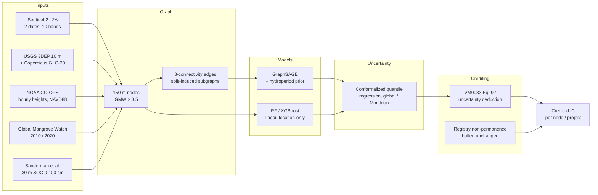
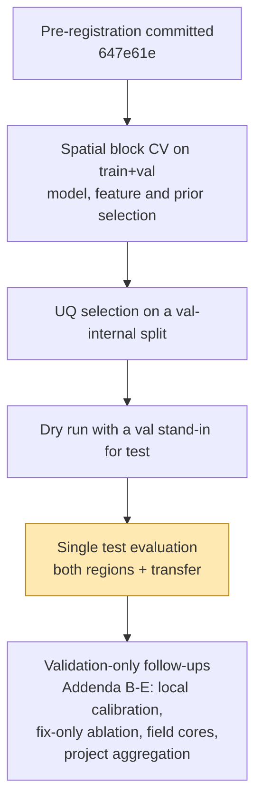

# Physics-Informed Graph Neural Networks with Uncertainty Quantification for Blue Carbon Crediting

Code, data pipeline and results for the ICDABI 2026 (DATA'26) paper by **Nahla Nabil Skaik**
(Faculty of Computer Studies, Arab Open University, Kingdom of Bahrain), revised after a
major-revision decision.

Mangrove carbon credits are discounted today by a flat non-permanence buffer that ignores how
uncertain the underlying carbon-stock estimate is. This project builds a spatial graph of
mangrove soil carbon from Sentinel-2, elevation and tide data, trains physics-informed graph
neural networks and tabular baselines, attaches calibrated (conformal) uncertainty to every
150 m node, and turns that uncertainty into a conservative, registry-compatible credit
deduction (Verra VM0033 v2.1, Eq. 92). Every model choice is fixed on validation data under a
pre-registered rule, and the test set is read once.

---

## Contents

- [Pipeline at a glance](#pipeline-at-a-glance)
- [Study regions and data](#study-regions-and-data)
- [Evaluation protocol](#evaluation-protocol)
- [Main results](#main-results)
- [Repository layout](#repository-layout)
- [Reproducing the results](#reproducing-the-results)
- [Revision record (ICDABI 2026 major revision)](#revision-record-icdabi-2026-major-revision)
- [Data sources](#data-sources)

---

## Pipeline at a glance



Estimation uncertainty and non-permanence risk are kept as **two separate factors**:

```
credited_i = stock_i x (1 - uncertainty_deduction_i) x (1 - non_permanence_buffer)
```

The uncertainty deduction follows VM0033 v2.1 (p. 64, Eq. 92): no deduction while the 90%
half-width is within 20% of the estimate, and a deduction equal to the excess beyond that.

## Study regions and data

| | Region 1 (R1) | Region 2 (R2) |
|---|---|---|
| Area | Ten Thousand Islands / Rookery Bay, SW Florida | Everglades NP coast (Lostmans to Shark River) |
| Bounding box | -81.90, 25.90, -81.40, 26.30 | -81.20, 25.30, -80.90, 25.60 |
| Nodes / directed edges | 10,124 / 64,366 | 22,326 / 143,034 |
| Train / val / test nodes | 6,465 / 1,583 / 2,076 | 14,499 / 3,351 / 4,476 |
| Tide gauge (NAVD88) | 8725114 Naples Bay North | 8723970 Vaca Key |
| Field soil cores (CCN, mangrove) | 56 | 31 |

Each node is a 5x5 block of the native 30 m SOC grid. Splits are spatial: fine-grid cells
(about 2.5 km) are assigned whole to train, validation or test, and **no edge crosses a split**
during training or inference.

**Features.** Feature sets F0 to F3 grow from the base bands (NDVI, B04, B08, B11, distance to
gauge) to all ten Sentinel-2 bands with red-edge and moisture indices (F1), elevation (F2) and a
second acquisition date with change terms (F3).

**Physics prior.** The selected prior (P2) encourages predictions toward an equal-weight,
coefficient-free combination of tidal **inundation frequency** (fraction of hours in 2025 that
the gauge water level exceeds node elevation) and red-edge canopy productivity (NDRE).

## Evaluation protocol



- Selection rules were written and committed **before** the experiments they govern
  (`paper/revision_preregistration.md`, git timestamps).
- `scripts/run_revision_test_eval.py` is the only script that reads test labels. It writes a
  run stamp and refuses to run twice without a logged reason.
- Every deviation (D1-D9) and every validation-only addendum (B-E) is logged with its reason and
  timing. Results added after the test read are labelled exploratory.

## Main results


*(a) Region-1 cross-validation R2 (grey, whiskers = fold range) and single test evaluation in
both regions (mean of 3 seeds). (b) Cross-region transfer without positional features. (c) 90%
interval quality on test, Winkler score (lower is better), dashed = trivial interval, coverage
printed above bars.*

**Point accuracy, test (mean of 3 seeds)**

| Model | R1 test R2 | R2 test R2 |
|---|---|---|
| Linear | -0.24 | 0.41 |
| Location only (RF on lon/lat) | -0.79 | 0.57 |
| Random Forest | 0.03 | 0.58 |
| RF + spatial lag | 0.01 | 0.59 |
| XGBoost | **0.20** | 0.59 |
| GraphSAGE | 0.07 (sd 0.24) | 0.58 |
| Physics-informed GraphSAGE (P2) | 0.17 (sd 0.05) | 0.57 |

For reference, the originally submitted model scored R2 = -0.38 on the same R1 test block, with
Sentinel-2 features that were misplaced by 9.18 km (see the revision record).

**Uncertainty, test, 90% nominal (selected method CQR-GNN, global calibration)**

| | Coverage | Mean width (t C/ha) | Winkler | rho(width, abs error) |
|---|---|---|---|---|
| R1 CQR-GNN | 91.5% | 273 | 306 | 0.54 |
| R1 trivial interval | 89.3% | 274 | 372 | n/a |
| R2 CQR-GNN | 89.1% | 191 | 247 | 0.15 |
| R2 trivial interval | 87.8% | 282 | 369 | n/a |

**Crediting**


- Per-node VM0033 deduction, median 12.7% (R1) and 2.1% (R2). Credited stock relative to the
  flat buffer alone: 0.88 (R1) and 0.97 (R2). The result holds across all five UQ methods,
  including the physics-informed quantile model.
- **Project-level aggregation matters.** VM0033's independent-error aggregation covered only
  18% (R1) and 33% (R2) of realized project-level errors on validation, against a 90% target,
  and implies no deduction. Correlation-aware aggregation covered 91% or more.
- Interval width does not track 2010-2020 mangrove loss (Spearman about -0.06), so estimation
  uncertainty is not a stand-in for non-permanence risk. The two factors are kept separate.
- Market practice (Berkeley VROD v2026-08): blue carbon projects with issuances hold a median
  realized buffer of 11.0% and have retired 73.5% of issued credits.

**Field cores (Smithsonian CCN library, validation only).** At 64 core locations, the median
absolute error against field 0-100 cm stocks is 12.6% (R1) and 10.5% (R2) for the
physics-informed GNN, against 14.1% / 13.3% for a constant regional mean. Neither published map
does materially better than that constant at core scale (Sanderman 10.1% / 16.1%, Radabaugh
12.6% / 15.8%). Field-calibrated conformal intervals reach 92% leave-one-study-out coverage and
imply a 22-29% VM0033 deduction.

## Repository layout

```
blue-carbon-pinn-gnn/
├── data/
│   ├── raw/                     Sentinel-2 clips, GMW, SOC, tides, validation references,
│   │                            CCN cores, region2/, market/ (VROD)
│   └── processed/               graph_nodes*.csv, graph_edges*.npy (R1), region2/
├── src/
│   ├── data_pipeline/           region.py, build_graph.py, build_rev_features.py,
│   │                            build_hydroperiod.py, build_region2.py, fetch_*.py
│   ├── models/                  rev_common.py (data, graph regime, all model families),
│   │                            rev_uq.py (CQR, NCP, ensemble, conformal calibration)
│   ├── pricing/issuance.py      VM0033 Eq. 92 deduction, revenue sensitivity
│   └── eval/nonpermanence.py    GMW 2010-2020 mangrove loss per node
├── scripts/
│   ├── run_rev_e1_cv.py               model and feature selection (spatial CV)
│   ├── run_rev_w2_physics_cv.py       physics-prior selection
│   ├── run_rev_e6_uq_val.py           UQ selection (validation)
│   ├── run_revision_test_eval.py      single test evaluation (both regions, transfer)
│   ├── run_rev_b_*, run_rev_c*_*      local calibration, fix-only ablation, two-date training
│   ├── run_rev_d_field_validation.py  CCN field-core comparison
│   ├── run_rev_e_*                    issuance under every UQ method, project aggregation
│   ├── run_rev_f_market_vrod.py       market-practice check
│   └── make_rev_fig*.py               figures
├── paper/                       main.tex, references.bib, figures/, revision_preregistration.md,
│                                NUMBER_SOURCE_LOG.md
└── results/                     every CSV/JSON behind a number in the paper
```

The `*_ext_temporal*` files and `paper/extension_temporal_notes.md` hold an earlier exploratory
two-date dC/dt experiment, kept for the record.

## Reproducing the results

The project runs on Python 3.12 with PyTorch and PyTorch Geometric. Keep the virtual environment
outside the repository: deeply nested Windows paths broke a DLL load once.

```bash
python -m venv C:/venvs/bcpg
C:/venvs/bcpg/Scripts/pip install -r requirements.txt xgboost openpyxl lerc pypdf

# data (region 1 graph is in the repo; these rebuild features and references)
python src/data_pipeline/build_rev_features.py r1
python src/data_pipeline/build_hydroperiod.py r1
python src/data_pipeline/fetch_radabaugh_bgc.py r1
python src/data_pipeline/build_region2.py            # region 2 graph, masks, 2010 epochs
python src/data_pipeline/build_rev_features.py r2
python src/data_pipeline/build_hydroperiod.py r2
python src/data_pipeline/fetch_radabaugh_bgc.py r2
python src/eval/nonpermanence.py r1 && python src/eval/nonpermanence.py r2

# selection on validation only
python scripts/run_rev_e1_cv.py
python scripts/run_rev_w2_physics_cv.py
python scripts/run_rev_e6_uq_val.py

# test, once (dry run first)
python scripts/run_revision_test_eval.py --dry-run
python scripts/run_revision_test_eval.py

# figures
python scripts/make_rev_fig1.py && python scripts/make_rev_fig2_map.py
```

Seeds are fixed in every script (models 1-3, CV folds 20261007, region-2 split 20261009).
Sentinel-2, 3DEP and GLO-30 are read from Microsoft Planetary Computer without an API key.

## Revision record (ICDABI 2026 major revision)

| Reviewer concern | What changed |
|---|---|
| Negative test R2 | Found and fixed a 9.18 km georeferencing error in the Sentinel-2 clip; reproduced the error from clean inputs (correlation 0.91-0.97 with the submitted columns); richer features; R1 test R2 now 0.17-0.20, R2 about 0.58 |
| No RF / XGBoost | Added RF, XGBoost, RF with spatial lag, and a location-only reference |
| Split leakage | Training and inference on split-induced subgraphs; 2-hop interior subset reported |
| Physics prior built on NDVI and gauge distance | Replaced by a hydroperiod prior (3DEP lidar elevation and a year of NOAA water levels) plus red-edge |
| Circular prior-generalisation metric | Reported only as a diagnostic; independent checks against a field-calibrated map and 87 field soil cores |
| CQR did not use the physics model | Physics-informed quantile GNN added; crediting reported under every UQ method |
| Intervals wider than the label SD | Compared against a trivial conformal interval; adaptivity and Winkler score reported |
| Arbitrary pricing parameters, risks conflated | VM0033 Eq. 92 deduction, kept separate from the registry buffer; tested against observed mangrove loss and market buffers |
| Single region, single date | Second region (Everglades coast), second Sentinel-2 date, two-date training, cross-region transfer with local calibration |
| Mondrian dropped after seeing test | Both calibrations reported throughout; Mondrian under-coverage traced to only 6 calibration blocks in R1 |

The full log of decisions, deviations and addenda is in
[`paper/revision_preregistration.md`](paper/revision_preregistration.md).

## Data sources

| Layer | Source |
|---|---|
| Sentinel-2 L2A | Copernicus, via Microsoft Planetary Computer |
| Elevation | USGS 3DEP seamless 1/3 arc-second; Copernicus GLO-30 (Planetary Computer) |
| Water levels | NOAA CO-OPS API, stations 8725114 and 8723970 |
| Mangrove extent | Global Mangrove Watch v3 (Bunting et al., Zenodo 6894273) |
| Soil organic carbon | Sanderman et al. 30 m mangrove SOC 2020 (Zenodo 7729492) |
| Independent carbon map | Radabaugh et al. 2023, FWC SW Florida Carbon Stocks Map |
| Field soil cores | Smithsonian Coastal Carbon Network Data Library (CCN_synthesis) |
| Market data | Berkeley Carbon Trading Project, Voluntary Registry Offsets Database v2026-08 (CC BY 4.0) |
| Registry rule | Verra VM0033 v2.1 (2023), copy in `paper/refs_primary/` |

Provenance, access dates and licensing notes for the original layers are in
[`data/README.md`](data/README.md).
