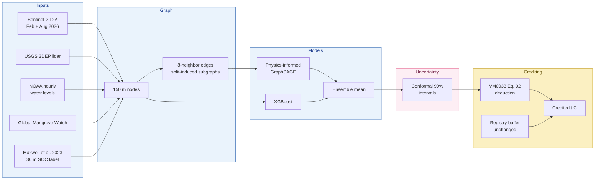
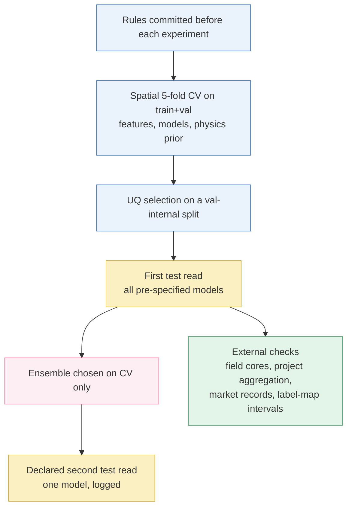

<div align="center">

# PIGNN-UQ

### Physics-Informed Graph Neural Networks with Uncertainty Quantification for Registry-Compatible Blue Carbon Crediting

**Nahla Nabil** · Faculty of Computer Studies, Arab Open University, Kingdom of Bahrain

[](#)
[](#)

[](https://www.python.org/)
[](https://pytorch.org/)
[](https://pyg.org/)
[](https://xgboost.ai/)
[](https://scikit-learn.org/)
[](#data-sources)
[](paper/main.tex)

</div>

---

> **The problem.** Mangrove carbon credits are discounted by a non-permanence buffer that does
> not depend on how uncertain the underlying carbon-stock estimate is.
>
> **What PIGNN-UQ does.** It maps mangrove soil carbon on a spatial graph, combines a
> physics-informed graph neural network with XGBoost, attaches a calibrated 90% conformal
> interval to every 150 m node, and converts that interval into the uncertainty deduction of
> **Verra VM0033 v2.1** (p. 64, Eq. 92), kept separate from the registry's non-permanence buffer.

<p align="center">
  
</p>

## Contents

| | | |
|---|---|---|
| [Key results](#key-results) | [Tech stack](#tech-stack) | [Pipeline](#pipeline) |
| [Regions and data](#study-regions-and-data) | [Evaluation protocol](#evaluation-protocol) | [Detailed results](#detailed-results) |
| [Repository layout](#repository-layout) | [Reproduce](#reproducing-the-results) | [Changes](#changes-from-the-first-version) |

---

## Key results

| | Region 1<br/>Ten Thousand Islands | Region 2<br/>Everglades coast |
|---|:---:|:---:|
| **Ensemble** (physics-informed GNN + XGBoost), CV R² | 0.47 | 0.55 |
| **Ensemble, test R²** (declared second read) | **0.28** | **0.60** |
| XGBoost alone, test R² | 0.20 | 0.59 |
| 90% interval coverage, test | 91.5% | 89.1% |
| Median VM0033 deduction per node | **12.7%** | **2.1%** |
| Project coverage, VM0033 independent-error rule | 18% | 33% |
| Project coverage, correlation-aware rule | 91% | 100% |

- **Field check:** at 25 sites (87 Smithsonian soil cores) the ensemble's median error is
  **10.1%**, against 15.0% for a regional mean and 14.1% / 15.1% for two published maps.
- **Market check:** the deduction is close to the **11.0%** median buffer of the seven blue
  carbon projects with issued credits (Berkeley VROD v2026-08).
- **Calibration matters:** the label map's own uncalibrated intervals would withhold about
  **65%** of credits.

---

## Tech stack

| Layer | Tools |
|---|---|
| **Language** | Python 3.12 |
| **Graph learning** | PyTorch 2.13, PyTorch Geometric 2.8 (GraphSAGE), custom physics-informed loss |
| **Tabular models** | XGBoost 3.4, scikit-learn 1.9 (random forest, linear, quantile models) |
| **Uncertainty** | Conformalized quantile regression, normalized conformal prediction, Mondrian calibration (own implementation in `src/models/rev_uq.py`) |
| **Remote sensing & GIS** | rasterio, shapely, pyproj, pystac-client, Microsoft Planetary Computer, LERC |
| **Analysis & plots** | NumPy, pandas, SciPy, matplotlib |
| **Paper** | LaTeX (IEEEtran), BibTeX, latexdiff |
| **Reproducibility** | Fixed seeds, pre-registered selection rules, test-read run stamp, git history |

---

## Pipeline



Estimation uncertainty and non-permanence risk stay **two separate factors**:

```
credited_i = stock_i x (1 - max(0, U_i - 0.20)) x (1 - b),   U_i = (upper_i - lower_i) / (2 stock_i)
```

The physics prior (P2) pulls predictions toward an equal-weight, coefficient-free combination
of tidal **inundation frequency** (share of 2025 hourly water levels above node elevation) and
red-edge canopy productivity (NDRE).

---

## Study regions and data

| | Region 1 (R1) | Region 2 (R2) |
|---|---|---|
| Area | Ten Thousand Islands / Rookery Bay, SW Florida | Everglades NP coast (Lostmans to Shark River) |
| Bounding box | -81.90, 25.90, -81.40, 26.30 | -81.20, 25.30, -80.90, 25.60 |
| Nodes / directed edges | 10,124 / 64,366 | 22,326 / 143,034 |
| Train / val / test nodes | 6,465 / 1,583 / 2,076 | 14,499 / 3,351 / 4,476 |
| Tide gauge (NAVD88) | 8725114 Naples Bay North | 8723970 Vaca Key |
| Field soil cores (CCN, mangrove) | 56 | 31 |

Each node is a 5x5 block of the native 30 m SOC grid. Fine-grid cells (about 2.5 km) are
assigned whole to train, validation or test, and **no edge crosses a split**.

<details>
<summary><b>Data sources</b></summary>

<a id="data-sources"></a>

| Layer | Source |
|---|---|
| Sentinel-2 L2A | Copernicus, via Microsoft Planetary Computer |
| Elevation | USGS 3DEP seamless 1/3 arc-second; Copernicus GLO-30 (Planetary Computer) |
| Water levels | NOAA CO-OPS API, stations 8725114 and 8723970 |
| Mangrove extent | Global Mangrove Watch v3 (Bunting et al., Zenodo 6894273) |
| Soil organic carbon label | Maxwell et al. 2023, 30 m mangrove SOC 2020 (Zenodo 7729492) |
| Independent carbon map | Radabaugh et al. 2023, FWC SW Florida Carbon Stocks Map |
| Field soil cores | Smithsonian Coastal Carbon Network, Coastal Carbon Library v1.7.0 |
| Market data | Berkeley Carbon Trading Project, Voluntary Registry Offsets Database v2026-08 (CC BY 4.0) |
| Registry rule | Verra VM0033 v2.1 (2023), copy in `paper/refs_primary/` |

Provenance, access dates and licensing notes are in [`data/README.md`](data/README.md).

</details>

---

## Evaluation protocol



- `scripts/run_revision_test_eval.py` is the only script that reads test labels. It writes
  `results/rev_test_RUN_STAMP.json` and refuses a second run without a logged reason.
- Every deviation (D1 to D9) and addendum (A to G) is logged in
  [`paper/revision_preregistration.md`](paper/revision_preregistration.md). Analyses run after
  the first test read are labelled exploratory.

---

## Detailed results

<p align="center">
  
</p>

*(a) R² by model: R1 cross-validation (yellow, whiskers = fold range) and test in R1 (blue) and
R2 (pink), mean of 3 seeds. (b) Ensemble generalization. (c) 90% Winkler score on test,
dashed = trivial interval, labels = coverage.*

<details open>
<summary><b>Point accuracy, test (mean of 3 seeds)</b></summary>

| Model | R1 CV | R1 test | R2 test |
|---|:---:|:---:|:---:|
| Constant (train mean) | n/a | -0.11 | -0.01 |
| Linear | 0.22 | -0.24 | 0.41 |
| Location only (RF on lon/lat) | 0.42 | -0.79 | 0.57 |
| Random forest | 0.38 | 0.03 | 0.58 |
| XGBoost | 0.41 | 0.20 | 0.59 |
| GraphSAGE | 0.39 | 0.07 (sd 0.24) | 0.58 |
| Physics-informed GraphSAGE (P2) | 0.41 | 0.17 (sd 0.05) | 0.56 |
| **Ensemble (physics-informed GNN + XGBoost)** | **0.47** | **0.28** | **0.60** |

The ensemble row comes from the declared second test read. The first version of the model
scored R² = -0.38 on the same R1 test block, with Sentinel-2 features misplaced by 9.18 km.

</details>

<details open>
<summary><b>Uncertainty, test, 90% nominal (CQR-GNN, global calibration)</b></summary>

| | Coverage | Mean width (t C/ha) | Winkler | ρ(width, abs error) |
|---|:---:|:---:|:---:|:---:|
| R1 CQR-GNN | 91.5% | 273 | 306 | 0.54 |
| R1 trivial interval | 89.3% | 274 | 372 | n/a |
| R2 CQR-GNN | 89.1% | 191 | 247 | 0.15 |
| R2 trivial interval | 87.8% | 282 | 369 | n/a |

</details>

**Generalization.** One ensemble trained on both regions reaches CV R² 0.37 (R1) and 0.53 (R2).
Zero-shot transfer scores below zero, and recalibrating intervals on half of the target's
validation nodes restores 88% to 97% coverage. Training on both image dates raises the
cross-date rank agreement of predictions from 0.44 to 0.88.

### Crediting

<p align="center">
  
</p>

- Per-node VM0033 deduction: median **12.7%** (R1) and **2.1%** (R2), close to the 11.0% median
  buffer of the seven blue carbon projects with issued credits (73.5% of them retired).
- **Calibration matters.** The label product's own 95% prediction limits contain all 13 deep
  field cores, but their median half-width is 101% of the estimate; under VM0033 they would
  withhold about 65% of credits (`scripts/run_rev_g_label_pi.py`).
- **Project aggregation matters.** VM0033's independent-error aggregation covered only 18% (R1)
  and 33% (R2) of realized project errors; correlation-aware aggregation covered 91% or more.
- Interval width does not track mangrove loss between 2010 and 2020 (Spearman about -0.06), so
  the uncertainty deduction and the non-permanence buffer stay separate.
- Over the 2,076 R1 test nodes (about 4,700 ha), the deducted share equals 0.71 Mt CO2e of
  standing stock, or US$19.2 million at US$26.96 per credit (an upper bound).

### Field cores (Smithsonian CCN, validation only)

| Source | Site-level median abs. error (25 sites) |
|---|:---:|
| Ensemble | **10.1%** |
| Physics-informed GNN | 11.6% |
| Maxwell et al. map | 14.1% |
| Constant regional mean | 15.0% |
| Radabaugh et al. map | 15.1% |
| XGBoost | 16.5% |

In the result files the column `sanderman` holds the Maxwell et al. (2023) label product.

---

## Repository layout

```
blue-carbon-pinn-gnn/
├── data/
│   ├── raw/                     Sentinel-2 clips, GMW, SOC, tides, validation references,
│   │                            CCN cores, region2/, market/ (VROD)
│   └── processed/               graph_nodes*.csv, graph_edges*.npy (R1), region2/
├── src/
│   ├── data_pipeline/           region.py, build_graph.py, build_rev_features.py,
│   │                            build_hydroperiod.py, build_region2.py, fetch_*.py
│   ├── models/                  rev_common.py (data, graph regime, all model families),
│   │                            rev_uq.py (CQR, NCP, ensemble, conformal calibration)
│   ├── pricing/issuance.py      VM0033 Eq. 92 deduction, revenue sensitivity
│   └── eval/nonpermanence.py    GMW 2010-2020 mangrove loss per node
├── scripts/
│   ├── run_rev_e1_cv.py               model and feature selection (spatial CV)
│   ├── run_rev_w2_physics_cv.py       physics-prior selection
│   ├── run_rev_e6_uq_val.py           UQ selection (validation)
│   ├── run_revision_test_eval.py      first test read (both regions, transfer)
│   ├── run_rev_f_cv.py                ensemble selection (spatial CV)
│   ├── run_rev_f2_uq.py, run_rev_f34.py  interval method, field sites, pooled model
│   ├── run_rev_f5_test2.py            declared second test read (ensemble only)
│   ├── run_rev_b_*, run_rev_c*_*      local calibration, fix-only ablation, two-date training
│   ├── run_rev_d_field_validation.py  CCN field-core comparison
│   ├── run_rev_e_*                    issuance under every UQ method, project aggregation
│   ├── run_rev_f_market_vrod.py       market-practice check
│   ├── run_rev_g_label_pi.py          label-map intervals against field cores
│   └── make_rev_fig*.py               figures
├── paper/                       main.tex, references.bib, figures/, revision_preregistration.md
└── results/                     every CSV/JSON behind a number in the paper
```

---

## Reproducing the results

Keep the virtual environment outside the repository: deeply nested Windows paths broke a DLL
load once.

**1. Environment**

```bash
python -m venv C:/venvs/bcpg
C:/venvs/bcpg/Scripts/pip install -r requirements.txt
C:/venvs/bcpg/Scripts/pip install xgboost openpyxl lerc pypdf
```

**2. Data** (the region 1 graph is in the repository; these rebuild features and references)

```bash
python src/data_pipeline/build_rev_features.py r1
python src/data_pipeline/build_hydroperiod.py r1
python src/data_pipeline/fetch_radabaugh_bgc.py r1
python src/data_pipeline/build_region2.py
python src/data_pipeline/build_rev_features.py r2
python src/data_pipeline/build_hydroperiod.py r2
python src/data_pipeline/fetch_radabaugh_bgc.py r2
python src/eval/nonpermanence.py r1
python src/eval/nonpermanence.py r2
```

**3. Model selection** (validation data only)

```bash
python scripts/run_rev_e1_cv.py
python scripts/run_rev_w2_physics_cv.py
python scripts/run_rev_e6_uq_val.py
python scripts/run_rev_f_cv.py
python scripts/run_rev_f2_uq.py
python scripts/run_rev_f34.py
```

**4. Test reads** (logged in `results/rev_test_RUN_STAMP.json`)

```bash
python scripts/run_revision_test_eval.py --dry-run
python scripts/run_revision_test_eval.py
python scripts/run_rev_f5_test2.py
```

**5. External checks and figures**

```bash
python scripts/run_rev_d_field_validation.py
python scripts/run_rev_g_label_pi.py
python scripts/make_rev_fig0_framework.py
python scripts/make_rev_fig1.py
python scripts/make_rev_fig2_map.py
```

Seeds are fixed in every script (models 1 to 3, CV folds 20261007, region-2 split 20261009).
Sentinel-2, 3DEP and GLO-30 are read from Microsoft Planetary Computer without an API key.

---

## Changes from the first version

| Issue in the first version | What changed |
|---|---|
| Negative test R² | Found and fixed a 9.18 km georeferencing error in the Sentinel-2 clip (reproduced from clean inputs); richer features; ensemble test R² 0.28 (R1) and 0.60 (R2) |
| No RF / XGBoost | Added RF, XGBoost, RF with spatial lag, a location-only reference and a constant baseline |
| Split leakage | Training and inference on split-induced subgraphs; 2-hop interior subset reported |
| Physics prior built on NDVI and gauge distance | Replaced by a hydroperiod prior (3DEP lidar and a year of NOAA water levels) plus red-edge |
| Circular prior-generalisation metric | Dropped as evidence; independent checks against 87 field soil cores and a field-calibrated map |
| CQR did not use the physics model | Physics-informed quantile GNN added; crediting reported under every UQ method |
| Intervals wider than the label SD | Compared against a trivial conformal interval; adaptivity and Winkler score reported |
| Arbitrary pricing parameters, risks conflated | VM0033 Eq. 92 deduction, kept separate from the registry buffer; tested against mangrove loss and market buffers |
| Single region, single date | Second region, second Sentinel-2 date, two-date training, pooled two-region model |
| Mondrian dropped after seeing test | Both calibrations reported throughout |
| Contribution unclear | Research-gap table and pipeline figure; contributions stated in the introduction |

---

<div align="center">

**Nahla Nabil** · Faculty of Computer Studies, Arab Open University, Kingdom of Bahrain

</div>
